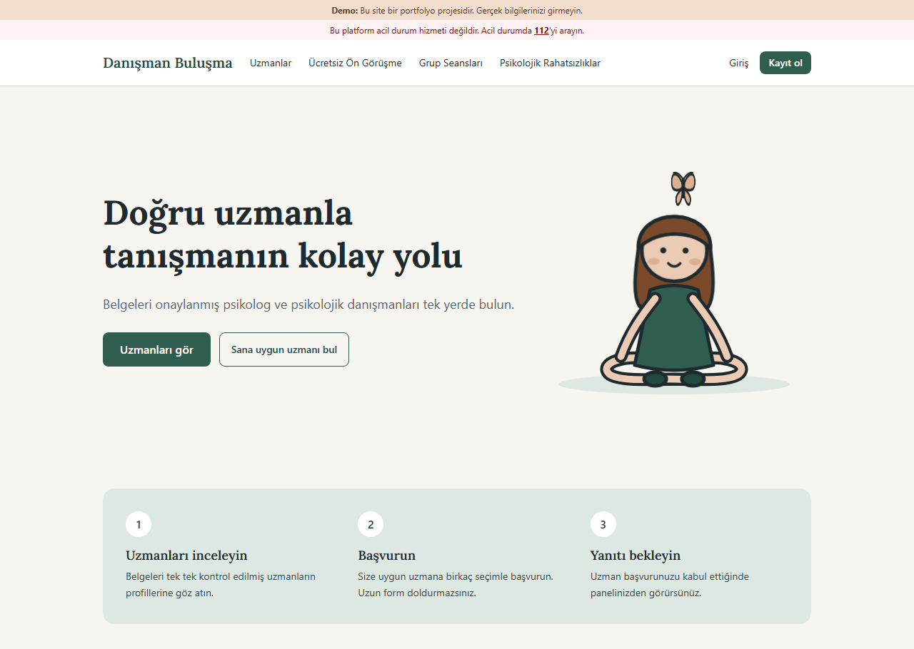
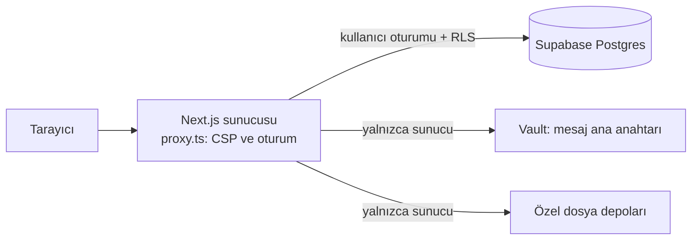
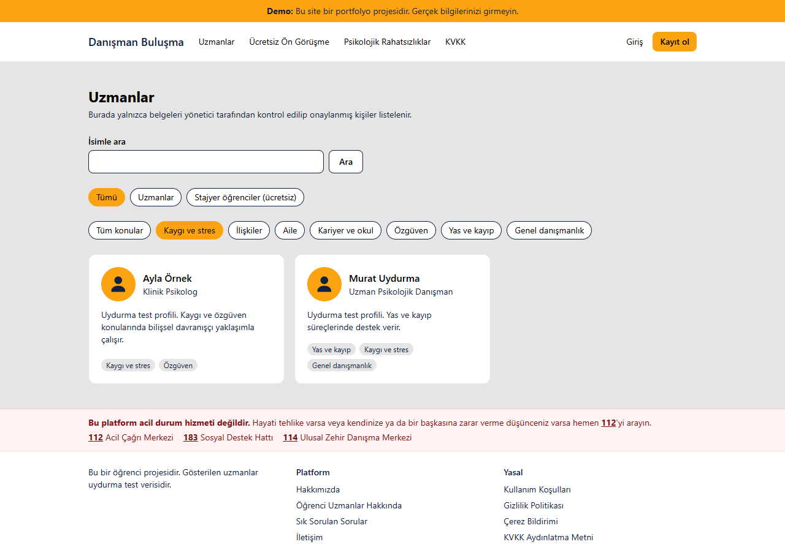
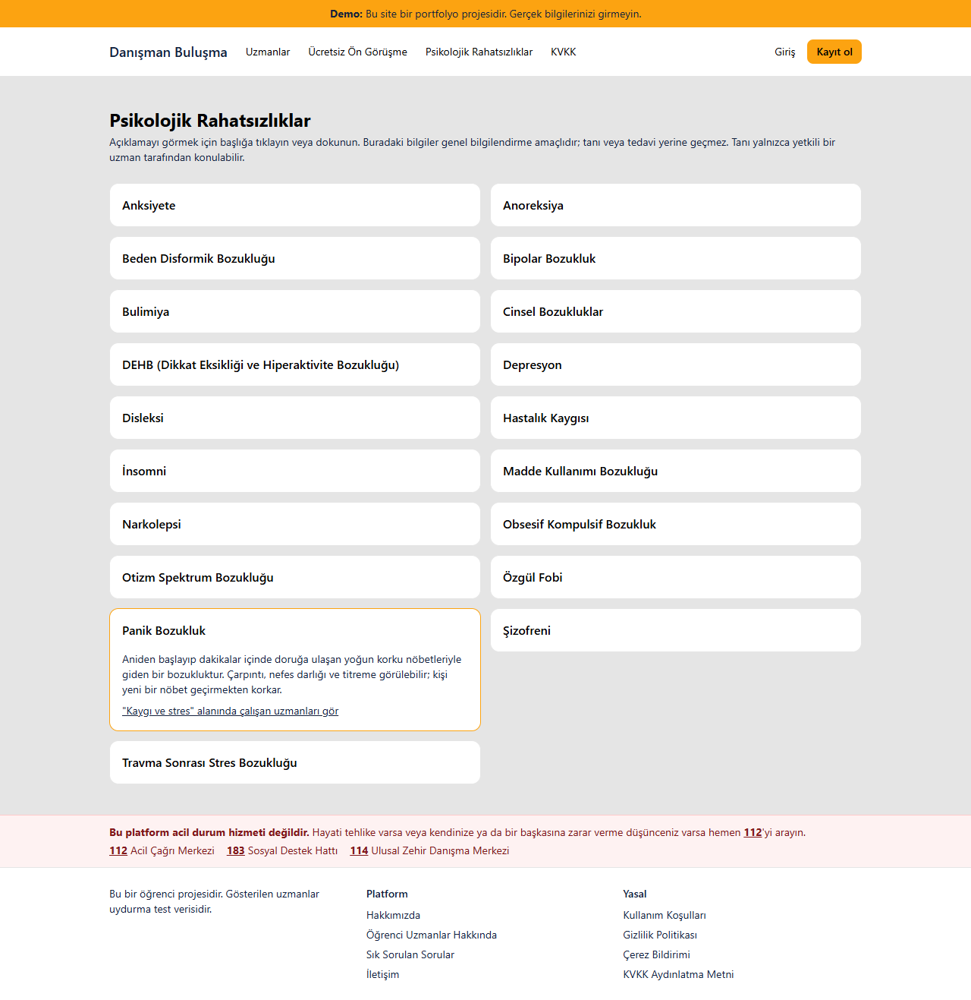

# Danışman Buluşma

Psikolog ve psikolojik danışmanlarla danışanları buluşturan Türkçe web platformu.
Yapay zekâ ajanlarıyla (Claude Code) geliştirilmiş bir portfolyo projesidir.

> **Demo:** Gerçek bir hizmet değildir. Tüm uzmanlar ve kullanıcılar uydurma test verisidir, ödeme demodur (para çekilmez, kart bilgisi istenmez), yasal metinler taslaktır. Sitede gerçek kişi bilgisi girmeyin.



## Kısaca

- 27 sayfa, 21 veritabanı değişiklik dosyası (migration), RLS (satır düzeyinde güvenlik) açık 19 tablo
- Mesajlar konuşma başına ayrı anahtarla, AES-256-GCM ile veritabanında şifreli saklanır
- Yönetici için zorunlu iki adımlı doğrulama, değiştirilemez işlem kayıtları, her istekte yeni nonce'lu CSP
- 69 otomatik test ve 5 SQL denetim dosyası
- Ölçek, öğrenci uzman ve ödeme bölümleri ayarla açılıp kapanan ayrı modüller

## Ajanlarla nasıl geliştirildi?

Tüm commit'ler Claude Code ile ortak yazıldı. Benim işim ne yapılacağını belirlemek, ajanı kurallarla sınırlamak ve çıktıyı doğrulamaktı.

| Adım | Kanıt |
|---|---|
| Kalıcı proje kuralları | [CLAUDE.md](CLAUDE.md), [AGENTS.md](AGENTS.md) |
| Koddan önce tasarım | [5 tasarım dokümanı](docs/superpowers/specs/) |
| Adım adım uygulama planı | [6 plan](docs/superpowers/plans/) |
| Ajanla güvenlik denetimi | "Güvenlik denetimi Bulgu" commit'leri, ertelenenler [YAYIN-ONCESI.md](YAYIN-ONCESI.md) içinde |
| Doğrulama | `npm test`, `npx eslint`, `npx tsc --noEmit`, `npm run build` ve `supabase/denetim/` |

## Neler var?

**Danışan**
- Uzmanları konuya ve isme göre arama; ücretsiz ön görüşme yapan uzmanları görme
- Uzmanın takviminden uygun saate başvurma, ödeme planını onaylama, seans iptali
- Grup seanslarına katılma (3-12 kişi, danışanlar birbirinin adını görmez)
- Başvuru kabul edilince uzmanla şifreli saklanan mesajlaşma ve uzmanın paylaştığı görüşme bağlantısına katılma
- En az 2 tamamlanmış seanstan sonra bağımsız uzmana 1-5 yıldız verme
- Okunmamış mesaj ve yanıtlanan başvuru sayaçları
- Sohbeti şikayet etme, şifre sıfırlama, hesabını silme
- Psikolojik rahatsızlıklar bilgi sayfası ve isteğe bağlı uzman bulma ölçeği (yanıtlar tarayıcıdan çıkmaz)

**Bağımsız uzman** (Psikolog veya Psikolojik Danışman)
- Kayıt, belge yükleme, yönetici onayından sonra `/uzmanlar` listesinde görünme
- Tanıtım yazısı, çalışma alanı, fotoğraf, görüşme şekli, seans süresi ve haftalık uygun saatleri düzenleme
- Başvuruları yanıtlama, ödeme planı gönderme, grup seansı açma, isteğe bağlı ücretsiz ön görüşme

**Öğrenci uzman** (isteğe bağlı bölüm, varsayılan kapalı)
- Yalnızca PDR 4. sınıf ve Klinik Psikoloji yüksek lisans öğrencileri, ayrı `/ogrenci-uzmanlar` listesinde
- Görüşmeleri ücretsizdir; ödeme, puanlama ve grup seansı yoktur

**Yönetici** (iki adımlı doğrulama zorunlu)
- Belge onayı veya reddi, tanıtım yazılarının sonradan kontrolü, uygunsuz fotoğrafı kaldırma
- Yalnızca işaretli sohbetleri, sebep yazarak ve 30 dakikalığına açma; her erişim silinemeyen bir kayda yazılır
- "Seans yapılmadı" bildirimlerinde iade veya aktarım kararı

**Teknoloji:** Next.js 16, TypeScript, Tailwind, Supabase (kimlik doğrulama, Postgres ve satır düzeyinde güvenlik, özel dosya depolama, Vault).



## Bilinen sınırlar

- Gerçek kullanıcılara açık değildir. Yayın için gereken güvenlik, hukuk ve içerik işleri [YAYIN-ONCESI.md](YAYIN-ONCESI.md) dosyasındadır.
- Mesajlar uçtan uca şifreli değildir: sunucu anahtara erişebilir, koruma veritabanında saklanan veri içindir.
- Tarayıcıda uçtan uca test ve otomatik CI henüz yoktur.
- Ürünün içinde yapay zekâ özelliği yoktur; yapay zekâ geliştirme sürecinde kullanıldı.

Açık kaynak lisansı verilmemiştir. Kod inceleme amacıyla paylaşılmıştır; izin alınmadan kullanılamaz.

<p>
  
  
</p>

## Bilgisayarınızda çalıştırma (Windows PowerShell)

### 1. Supabase projesi oluşturun (bir kez yapılır)

1. https://supabase.com adresinde ücretsiz hesap açın.
2. **New project** düğmesine tıklayın. Proje adı verin, bir veritabanı şifresi belirleyin
   (bir şifre yöneticisinde saklayın) ve **Region** olarak **Central EU (Frankfurt)** seçin.
3. Proje açılınca sol menüden **SQL Editor** > **New query** yolunu izleyin.
   `supabase/migrations/` klasöründeki dosyaları **numara sırasıyla** (önce `0001_...`, sonra `0002_...`)
   ayrı ayrı yapıştırıp **Run** düğmesine basın. Her birinde "Success" yazısını görmelisiniz.
   Bir dosyayı yalnızca **bir kez** çalıştırın; ikinci kez çalıştırırsanız "already exists" hatası alırsınız. Bu hata zararsızdır.
   İsterseniz sonra `supabase/denetim/` klasöründeki dosyaları da çalıştırın: seans, ödeme ve grup kurallarını uydurma kayıtlarla sınarlar, sonunda hepsini geri alırlar. Hata vermemeli.
4. **Authentication** > **Sign In / Providers** > **Email** bölümünde **Confirm email** seçeneğini
   kapatın. Bu adım yalnızca test içindir: Supabase'in ücretsiz e-posta gönderimi saatte birkaç e-postayla sınırlı.
5. **Project Settings** > **API Keys** sayfasından şunları kopyalayın:
   - **Publishable key** (`sb_publishable_...` ile başlar)
   - **Secret key** (`sb_secret_...` ile başlar, **gizlidir**)
   - Proje adresi (`https://xxxx.supabase.co`): **Project Settings** > **Data API** sayfasında
     veya üstteki **Connect** düğmesinde bulunur.

### 2. Projeyi çalıştırın

```powershell
cd "D:\web sitesi geliştirme"
npm install
Copy-Item .env.example .env.local
notepad .env.local
```

Not Defteri'nde açılan `.env.local` dosyasını kopyaladığınız bilgilerle doldurun. Ayrıca
`SEED_TEST_SIFRESI` satırına test hesapları için en az 8 karakterlik bir şifre yazın. Sonra dosyayı kaydedip kapatın.

```powershell
npm run test-verisi
npm run dev
```

Tarayıcıda **http://localhost:3000** adresini açın. Sunucuyu durdurmak için PowerShell penceresinde `Ctrl + C` tuşlarına basın.

### Test hesapları

Tüm test hesaplarının şifresi, `.env.local` dosyasına yazdığınız `SEED_TEST_SIFRESI` değeridir.

| E-posta | Rol |
|---|---|
| test.danisan@example.com | Danışan |
| test.uzman1@example.com … test.uzman4@example.com | Uzman (onaylı) |
| test.ogrenci1@example.com, test.ogrenci2@example.com | Öğrenci uzman (onaylı; listede görünmesi için `OGRENCI_MODULU_AKTIF=true` gerekir) |

### Sık karşılaşılan sorunlar

- **"running scripts is disabled on this system"**: PowerShell, npm'in betiklerini engelliyor.
  Bir kez şu komutu çalıştırın: `Set-ExecutionPolicy -Scope CurrentUser RemoteSigned`
- **Sayfanın üstünde sarı "Veritabanı bağlantısı ayarlanmamış" uyarısı**: `.env.local` dosyası boş
  veya yanlış yerde. Dosyayı düzelttikten sonra `npm run dev` komutunu yeniden başlatın.
- **Uzman listesi boş**: `npm run test-verisi` komutunu çalıştırdığınızdan emin olun.
- **`SEED_TEST_SIFRESI` değerini sonradan değiştirdim**: Daha önce oluşturulmuş test hesaplarının şifresi
  değişmez; eski şifre geçerli kalır.

## Kendinizi güvenli şekilde admin yapma

Admin yetkisi kayıt formundan **hiçbir şekilde** alınamaz. Bu kural veritabanında da uygulanır:
kayıt sırasında rol yalnızca danışan/uzman/öğrenci olabilir ve kullanıcılar rol alanını değiştiremez.
Admin yapmanın tek yolu, Supabase paneline erişimi olan kişinin (yani sizin) SQL çalıştırması.

1. Sitede **Kayıt ol** sayfasından kendinize normal bir hesap açın (**Danışan** seçin).
2. Supabase panelinde **SQL Editor** > **New query** yolunu izleyin, aşağıdaki komutu yapıştırın. E-posta adresini kendi
   adresinizle değiştirip **Run** düğmesine basın:
   ```sql
   update public.profiles
   set role = 'admin'
   where id = (select id from auth.users where email = 'sizin-epostaniz@ornek.com');
   ```
3. Doğru çalıştığını kontrol edin. Aşağıdaki komut tek satır ve `admin` göstermeli:
   ```sql
   select p.role, u.email from public.profiles p join auth.users u on u.id = p.id where p.role = 'admin';
   ```
4. Sitede çıkış yapıp tekrar giriş yapın. Üst menüde **Yönetim** bağlantısı görünecek.
5. **İki adımlı doğrulamayı kurun.** Yönetim bağlantısına ilk tıkladığınızda kurulum sayfası açılır:
   telefonunuza Google Authenticator veya Microsoft Authenticator gibi bir uygulama kurun, ekrandaki QR kodu
   okutun ve uygulamadaki 6 haneli kodu girin. Bundan sonra her girişte bu kod istenir.
   Kod girilmeden admin paneli açılmaz ve veritabanı hiçbir admin işlemine izin vermez.

**Telefonu kaybederseniz (kurtarma):** SQL Editor'de aşağıdaki komutu, e-postayı kendi adresinizle değiştirerek çalıştırın.
Sonra siteye girip doğrulama uygulamasını yeniden kurun.
```sql
delete from auth.mfa_factors
where user_id = (select id from auth.users where email = 'sizin-epostaniz@ornek.com');
```

**Güvenlik önerileri:**
- Supabase hesabınızda iki adımlı doğrulamayı (MFA) açın, çünkü admin yapma yetkisi bu hesapta.
- Admin hesabı için uzun ve başka yerde kullanmadığınız bir şifre seçin.
- Admin yetkisini geri almak için: `update public.profiles set role = 'client' where id = (select id from auth.users where email = '...');`

## Belgeler ve fotoğraflar nasıl korunuyor?

- **Belgeler** `uzman-belgeleri` adlı **özel** depoda durur. Dosyayı sadece admin açabilir.
  "Görüntüle" bağlantısı 60 saniye geçerli tek seferlik bir link üretir ve her görüntüleme kaydedilir.
  Admin onay ya da ret kararı verdiğinde belge dosyaları silinir; sadece "hangi belge, ne zaman" bilgisi kalır.
- **Profil fotoğrafları** ayrı bir özel depoda (`profil-fotograflari`) durur. Yüklenen fotoğraf 400×400'e
  küçültülür, WebP biçimine çevrilir ve içindeki konum, kamera gibi gizli bilgiler (EXIF) silinir.
  Fotoğraf, uzman onaylanana kadar başkalarına gösterilmez.
- Dosya türü, dosya adına değil dosyanın içeriğine bakılarak kontrol edilir. Örneğin adı `.pdf` olan bir HTML dosyası reddedilir.

## Mesajlaşma nasıl çalışıyor?

- Konuşma, sadece uzman başvuruyu **kabul ettiğinde** açılır.
- Her iki taraf, ilk mesajdan önce KVKK aydınlatma metnini ve açık rıza metnini onaylar. Onay; kullanıcı, tarih/saat ve
  metin sürümüyle kaydedilir. KVKK sayfasında herkes kendi onay kayıtlarını görebilir.
- Mesajlar veritabanında **şifreli** durur. Şifreleme anahtarı Supabase Vault'ta tutulur.
  **Vault'taki `mesaj_ana_anahtari` sırrını silmeyin**; silinirse eski mesajlar bir daha okunamaz.
- Mesajları **varsayılan olarak sadece konuşmanın iki tarafı** okuyabilir.
- Taraflar bir sohbeti **"Bu sohbeti şikayet et"** ile bildirebilir. Admin, **Yönetim > Şikayetler ve incelemeler**
  sayfasında sadece şikayet edilmiş veya incelemeye alınmış sohbetleri görür. Bu sohbetleri de sebep yazarak ve
  30 dakikalığına açabilir. Her erişim (admin, tarih/saat, sohbet, sebep) silinemeyen bir kayda yazılır.
- Spam koruması: bir kişi dakikada en fazla 8, günde en fazla 200 mesaj gönderebilir.
- Uzman hesabını silerse sohbet danışanda, uzmanın adı olmadan, salt okunur olarak en fazla 6 ay kalır. Danışan bunu daha önce silebilir.
- Sohbet ekranında 112 ve kriz hatlarını gösteren, kapatılamayan bir acil durum kutusu var.
- Yeni mesajlar, sayfa açıkken 10 saniyede bir otomatik olarak yüklenir.

## Canlı demo yayınlama (Vercel)

1. Kodu GitHub'a gönderin. `.env.local` dosyası git'e gitmez; bunu kontrol edin.
2. https://vercel.com adresinde hesap açın, **Add New > Project** ile depoyu seçin.
3. **Environment Variables** bölümüne `.env.example` dosyasındaki değişkenleri ekleyin.
   `NEXT_PUBLIC_SITE_URL` değerine Vercel'in verdiği adresi yazın. `SEED_TEST_SIFRESI` gerekmez.
4. **Deploy** düğmesine basın.
5. Supabase'de **Authentication > URL Configuration** bölümünde **Site URL** alanına aynı adresi yazın,
   **Redirect URLs** listesine `adresiniz/**` ekleyin.

Demo hesaplarının şifresini herkese açık bir yere yazmayın. Paylaşacağınız kişiye ayrıca iletin.

## Modülleri açıp kapatma

`.env.local` dosyasında ayarlanır. Değiştirdikten sonra `npm run dev` komutunu yeniden başlatın.

| Ayar | `true` iken | `false` iken |
|---|---|---|
| `OLCEK_MODULU_AKTIF` | Ana sayfada uzman bulma ölçeği açılır (davet penceresi + "Sana uygun uzmanı bul" düğmesi). Yanıtlar tarayıcıdan çıkmaz. | Modül tamamen gizlidir, site normal çalışır. |
| `OGRENCI_MODULU_AKTIF` | Öğrenci uzman menüsü, listesi, bilgi sayfaları, profilleri ve kaydı açılır. | Bu bölüm kapanır, veri silinmez; mevcut öğrenci hesapları ve sohbetleri çalışır. |
| `ODEME_MODULU_AKTIF` | Demo ödeme açılır (para çekilmez). | Plan ve onay çalışmaya devam eder, ödeme adımı görünmez. |
| `KVKK_METINLERI_ONAYLI` | "Taslaktır" notları kalkar. Yalnızca metinler avukat onayından geçtikten sonra açılmalıdır. | Yasal metinlerde "Taslaktır" notu görünür. |

## Kontroller

```powershell
npm test
npx eslint
npx tsc --noEmit
npm run build
```
